


 

 



 


<table>
<tr>
<td width="50%"><a href="https://github.com/fayizulrahuman/fallguard"></a></td>
<td width="50%"><a href="https://github.com/fayizulrahuman/VitalSync"></a></td>
</tr>
<tr>
<td width="50%"><a href="https://github.com/fayizulrahuman/hidden-gems"></a></td>
<td width="50%"><a href="https://github.com/fayizulrahuman/fintrack"></a></td>
</tr>
</table>

 


 



  

